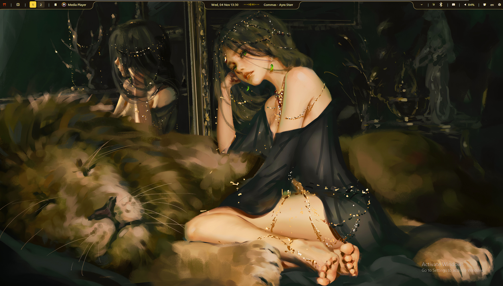
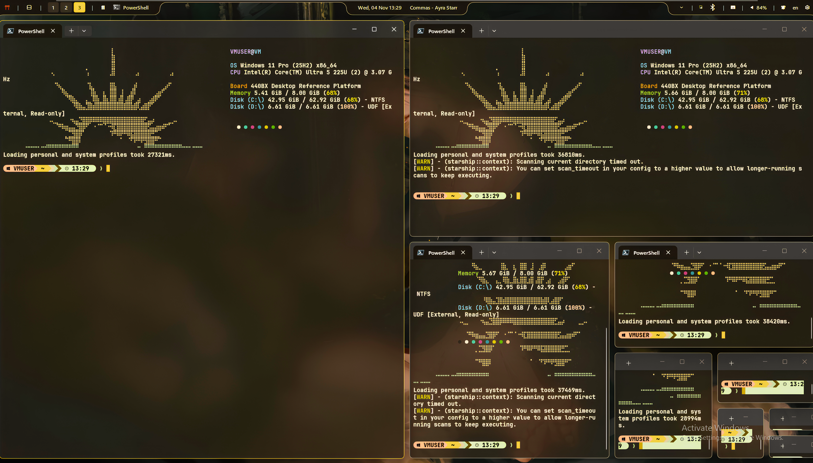
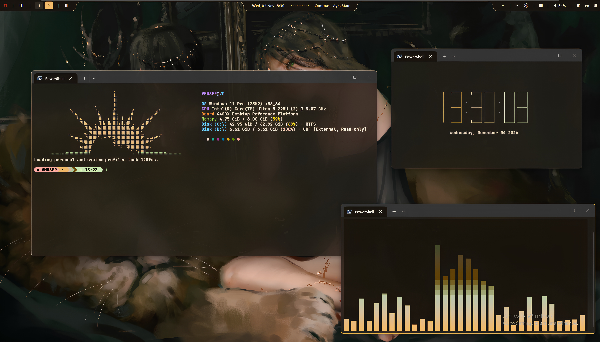
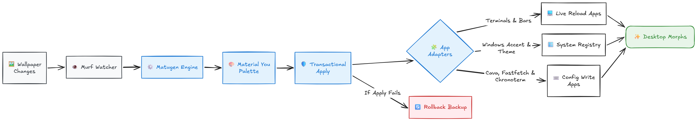

# Murf

<p align="center">
  
</p>

<h3 align="center">Wallpaper-driven theming for Windows.</h3>

<p align="center">
  Your wallpaper changes. Your desktop follows.
</p>

<p align="center">
  <a href="https://github.com/NitroBeast76/Murf">
    
  </a>
  <a href="https://github.com/NitroBeast76/Murf/releases">
    
  </a>
  <a href="https://github.com/NitroBeast76/Murf/issues">
    
  </a>
  
  
  
</p>

---

## Your wallpaper has changed. Your desktop hasn't gotten the memo.

Murf is a wallpaper-driven theming engine for Windows that keeps your desktop's visual identity in sync with your wallpaper.

Powered by [Matugen](https://github.com/InioX/matugen) and Material You, Murf extracts a dynamic color palette from your wallpaper and injects it into your favorite applications, desktop utilities, and Windows itself.

Change your wallpaper, and your desktop changes with it.

No manually editing twelve configuration files. No hunting down hexadecimal colors. No spending your evening wondering why your terminal is still blue while everything else has turned orange.

Just a wallpaper. A palette. An entirely different desktop.

**Your desktop, in harmony. Automatically.**

## 🖼️ The Desktop, Reimagined

<p align="center">
  
</p>

<p align="center">
  
  
</p>

## 🎬 See Murf in Action

<p align="center">
  
</p>

Your wallpaper changes.
Your palette follows.
Your desktop morphs.

## ✨ Features

| Feature | Description |
|---|---|
| 🎨 **Instant Morphing** | Detects wallpaper changes and applies the resulting palette automatically. |
| 🛡️ **Transactional Apply** | Uses a transactional journal to restore files to their previous state if an application fails during theming. |
| ⚡ **Zero-Config Start** | Automatically discovers supported applications using standard installation paths. |
| 🔄 **Live Reloads** | Refreshes supported applications without unnecessarily disrupting your desktop layout. |
| ⌨️ **Global Hotkey** | Press `Ctrl + Alt + M` to force an immediate theme re-apply. |
| 🖥️ **System Integration** | Can update Windows accent colors and light/dark mode alongside application themes. |
| 🧩 **Modular Adapters** | Applications can be enabled, disabled, or individually controlled. Missing applications are simply skipped. |
| ⚙️ **Custom Paths** | Supports custom configuration paths for portable installations and unconventional dotfile setups. |
| 📋 **Persistent Logs** | Keeps diagnostic logs locally so you can investigate problems without consulting a crystal ball. |

## 🖼️ How it works

Murf follows a simple principle:

**The wallpaper is the source of truth. Everything else follows.**

<p align="center">
  
</p>

Murf watches for wallpaper changes, waits for the configured settling period, and generates a fresh theme using Matugen.

The resulting palette is then applied through Murf's application adapters. Configuration files are updated, supported applications are refreshed, and Windows system colors can be adjusted.

If an apply operation fails, Murf's transactional journal provides a rollback mechanism rather than leaving your configuration files halfway through a makeover.

Because not every application supports safe live reloading, some changes take effect the next time the application starts.

### The result?

A desktop that doesn't merely *have* a color scheme.

A desktop that **has a color scheme because of its wallpaper.**

## 🧩 Supported applications

Murf currently supports the following applications and Windows components.

| Application | What Murf does |
|---|---|
| **Windows Terminal** | Applies dynamic terminal colors. |
| **GlazeWM** | Injects dynamic window-management colors and effects. |
| **YASB** | Applies dynamic status-bar colors through its stylesheet. |
| **Starship** | Uses Murf-generated configuration for a dynamically themed prompt. |
| **Fastfetch** | Applies dynamic terminal colors and supports custom ASCII logos. |
| **Windows 11 Accent Color** | Updates Windows accent colors, including title-bar and UI accents. |
| **Windows 11 Theme** | Switches Windows between light and dark mode. |
| **Chronoterm** | Updates its theme configuration. |
| **Cava** | Updates its color configuration. |

Applications that are not installed are automatically skipped.

### Live reloads vs. next-launch reloads

Not every application is equally cooperative.

Murf refreshes applications such as YASB, GlazeWM, and Windows Terminal without breaking your existing layout.

CLI applications such as Cava and Chronoterm cannot be safely live-reloaded through Murf.

Their configuration files are updated immediately, but the new colors appear the next time you launch them.

In other words:

- **Live-reload applications:** change wallpaper → theme updates → application refreshes.
- **CLI applications:** change wallpaper → configuration updates → restart application → new theme.

No mysterious failures. Just applications having different opinions about what constitutes a reload.

## 🚀 Installation

Getting Murf running is deliberately uncomplicated.

### 1. Download Murf

Head to the [Releases page](https://github.com/NitroBeast76/Murf/releases) and download `murf.exe`.

### 2. Give it a permanent home

Place the executable somewhere convenient and permanent.

For example:

```text
C:\Users\YourName\Tools\Murf\
```

Avoid temporary folders or locations you regularly clean out.

### 3. Launch Murf

Double-click `murf.exe`.

Murf will start running in the background and appear in your system tray.

### 4. Enable startup

Right-click the Murf tray icon and select:

**Start at login**

Your wallpaper-driven theming will now be available whenever you sign in.

That's it.

No elaborate installation ritual. No summoning circles. No registry archaeology.

## ⚙️ Configuration

Murf generates its configuration file automatically on first run.

```text
%APPDATA%\Murf\murf.toml
```

The configuration is heavily commented, so you can inspect the available settings directly.

You don't need to configure every adapter. Murf automatically skips applications that aren't installed.

### Custom application paths

Murf discovers applications through their standard installation locations.

If you use portable applications, custom dotfile directories, or simply prefer keeping your configuration somewhere else, you can specify custom paths.

#### YASB

```toml
[apps.yasb]
enabled = true
config_dir = "D:\\Dotfiles\\yasb"
```

#### GlazeWM

```toml
[apps.glazewm]
enabled = true
config_path = "D:\\Dotfiles\\glazewm\\config.yaml"
```

Use double backslashes (`\\`) when writing Windows paths in TOML strings.

### Enable or disable adapters

Each application has its own configuration section.

For example:

```toml
[apps.yasb]
enabled = true

[apps.glazewm]
enabled = true
```

Set an application's `enabled` value to `false` to stop Murf from applying themes to it.

This is particularly useful if you prefer manually managing one application's colors while allowing everything else to remain dynamic.

### Adjusting morph speed

Murf includes a settling delay to prevent premature theme generation while wallpapers are still changing.

```toml
[general]
settle_delay_ms = 500
```

The value determines how long Murf waits after detecting a wallpaper change before applying the new theme.

| Value | Behaviour |
|---|---|
| `500` | Snappy response for most setups. |
| `1000` | Slightly more relaxed. |
| `2000` | Useful for slower-loading or frequently changing wallpapers. |

If you're using animated wallpapers or a wallpaper application that updates images frequently, a longer settling period may be useful.

### Custom Fastfetch ASCII art

The default logo is not sacred.

If you'd rather have an ASCII rendition of your favorite character, monument, or questionable architectural decision, Murf supports custom Fastfetch logo sources.

```toml
[apps.fastfetch]
enabled = true
logo_source = "C:\\Users\\YourName\\my-ascii-art.txt"
```

Create a `.txt` file containing your ASCII art and point `logo_source` to it.

Remember to escape Windows path separators.

Your terminal. Your logo. Your unnecessarily elaborate ASCII masterpiece.

## 🛠️ Application setup

Murf can manage the color palette, but some applications still require a little initial configuration.

The `examples/` directory contains ready-to-use configuration snippets.

### PowerShell Profile

Copy the contents of:

```text
examples/profile.ps1
```

into your PowerShell profile.

This ensures Fastfetch and Starship use Murf's generated configurations.

### YASB

Copy the `:root` block from:

```text
examples/yasb-styles.css
```

into your YASB `styles.css`.

The example replaces hardcoded colors with dynamic variables, allowing Murf's palette to propagate throughout the status bar.

### GlazeWM

Copy the `window_effects` block from:

```text
examples/glazewm-config.yaml
```

into your GlazeWM `config.yaml`.

Pay attention to the `*murf_primary` anchor.

Murf automatically injects the corresponding anchor definitions at the top of the configuration file.

This allows GlazeWM's window effects to follow the generated palette rather than remain permanently attached to one color scheme.

## 🎮 Usage

Once Murf is running, most of the time you can simply forget it exists.

Which is, frankly, the point.

### System tray

Right-click the Murf tray icon to access its controls.

| Action | Purpose |
|---|---|
| **Apply Now** | Immediately re-apply the current theme. |
| **Pause Watching** | Temporarily stop wallpaper monitoring. |
| **Toggle Adapters** | Enable or disable individual application adapters. |
| **Start at login** | Configure automatic startup. |
| **Quit** | Exit Murf. |

### Global hotkey

```text
Ctrl + Alt + M
```

Forces an immediate theme re-apply.

Useful when an application refuses to cooperate, a configuration has been manually edited, or you simply want to see the current palette applied again.

### Logs

Murf stores its logs at:

```text
%LOCALAPPDATA%\Murf\logs\murf.log
```

If something goes wrong, this is the first place to look.

## 🔍 Troubleshooting

### My application isn't changing colors.

First, verify that the application is enabled in `murf.toml`.

Then check whether the application is using a standard installation path or requires a custom path.

Finally, verify that its configuration contains the Murf-compatible theme variables or configuration blocks.

Murf can update configuration files, but it cannot magically replace every hardcoded color in an arbitrary application configuration.

### My terminal changed colors, but Cava didn't.

That's expected.

Cava cannot safely live-reload through Murf.

Its configuration has been updated, but the new colors will appear the next time you launch it.

### My wallpaper changed, but the theme didn't.

Try the following:

1. Verify that Murf is running in the system tray.
2. Check whether wallpaper watching has been paused.
3. Use `Ctrl + Alt + M` to force a manual re-apply.
4. Check the Murf log for errors.
5. Verify that the relevant application adapter is enabled.

### I changed a configuration file, and now something looks wrong.

Murf's transactional journal is designed to restore files to their previous state when an apply operation fails.

For manual configuration changes, however, keep a backup of your files before making substantial edits.

A rollback mechanism is excellent.

A backup is still excellent.

## 🧹 Uninstallation

Leaving the dynamic theming lifestyle?

No hard feelings.

### 1. Quit Murf

Right-click the system tray icon and select:

**Quit**

### 2. Remove the executable

Delete `murf.exe` from its installation directory.

### 3. Remove Murf's data (optional)

Delete the following directories if you want to remove Murf's configuration and logs:

```text
%APPDATA%\Murf\
%LOCALAPPDATA%\Murf\
```

### 4. Restore application configurations (optional)

Murf does not automatically remove all Murf-related configuration blocks from your application files during uninstallation.

If you wish to restore your previous appearance, remove the Murf-related blocks from your configurations manually or restore your backups.

Your applications will continue functioning without Murf; they simply stop receiving dynamic palette updates.

## 🧠 Philosophy

Murf exists because desktop customization should be more than a collection of disconnected configuration files.

A wallpaper is often the visual foundation of a desktop. Yet the applications surrounding it traditionally require manual work to maintain a coherent appearance.

Murf closes that gap.

It brings wallpaper-driven color generation and application theming into one automated workflow, allowing the desktop to adapt naturally as its visual identity changes.

**Less configuration maintenance. More actual customization.**

Or, put another way:

> Spend your time making your desktop beautiful, not making twelve applications agree on what beautiful means.

## 🧱 Built with

<p align="center">
  <a href="https://www.rust-lang.org/">
    
  </a>
  <a href="https://github.com/InioX/matugen">
    
  </a>
  <a href="https://github.com/NitroBeast76/Murf">
    
  </a>
</p>

Murf is built in Rust and powered by Matugen's Material You color generation.

## 📜 License

See the repository's `LICENSE` file for licensing information.

## ⭐ Support the project

If Murf makes your desktop a little more enjoyable, consider giving the repository a star.

It costs nothing, takes a second, and makes the project a little easier for other Windows customization enthusiasts to discover.

[⭐ Star Murf on GitHub](https://github.com/NitroBeast76/Murf)

---

<p align="center">
  <strong>Murf</strong>
  <br>
  <em>One wallpaper. One palette. An entire desktop.</em>
</p>
